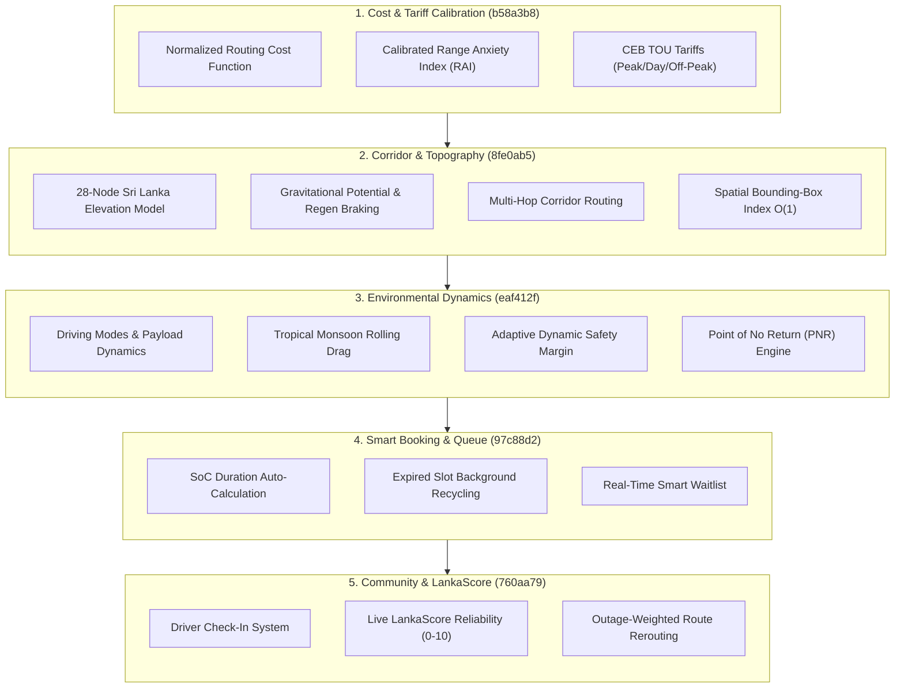

# EVayLanka: `improvements` Branch Comprehensive Documentation

> **Document Version:** 1.0.0  
> **Target Audience:** Engineering Team, Product Managers, Researchers, and Stakeholders  
> **Repository:** `EVayLanka`  
> **Source Branch:** `improvements` (`origin/improvements`)  

---

## Executive Summary

The `improvements` branch transitions EVayLanka from a basic map-and-charger locator into an intelligent, physics-informed Electric Vehicle (EV) navigation and charging management platform specifically calibrated for Sri Lanka's geography, electrical grid, and climate.

Across the primary milestones (`b58a3b8` through `760aa79`, and the subsequent map transition `429f657`), the improvements introduce:
1. **Mathematical Routing & Tariff Calibration:** A normalized dimensionless routing cost function, calibrated Range Anxiety Index (RAI), and official Ceylon Electricity Board (CEB) time-of-use (TOU) tariffs.
2. **Topographical & Corridor Navigation:** A 28-node Gaussian Radial Basis elevation model for the Sri Lanka Central Highlands, kinetic/gravitational energy modeling with regenerative braking, multi-hop charging corridor planning, and $O(1)$ spatial bounding-box indexing.
3. **Environmental Dynamics & Safety:** Monsoon rolling-resistance multipliers, driving mode adaptations, payload mass calculations, dynamic safety margins, and "Point of No Return" (PNR) turnaround safety warnings.
4. **Smart Session Booking & Queue Management:** Auto-calculated charging session duration based on real-time State-of-Charge (SoC), automatic recycling of expired slots, and a real-time Firestore waitlist.
5. **Crowdsourced Station Reliability ("LankaScore"):** Real-time driver check-ins with Sri Lanka-specific fault tagging (grid outages, tripped breakers, ICE-ing), a dynamic 0–10 reliability score with outage recency penalties, and reliability-weighted routing.
6. **Migration from Google Maps to OpenStreetMap (OSM) & OSRM:** Total decoupling from proprietary Google Maps API keys by introducing `flutter_map` OpenStreetMap rendering, OSRM routing, Nominatim geocoding, and an offline 46-city Sri Lanka fallback directory.

---

## Detailed Milestone Breakdown

---

### Pillar 1: Research Calibration, Normalized Cost Function, & CEB Tariffs
* **Commit Hash:** `b58a3b8`
* **Key Files:** `evay_app/lib/services/smart_route_service.dart`, `evay_app/lib/services/range_anxiety_service.dart`, `evay_app/lib/services/simulation_service.dart`, `evay_app/lib/models/range_anxiety.dart`

#### Problem Solved
Early route evaluation used raw sums of mismatched physical units (kilometers, kilowatt-hours, and minutes), leading to biased routing decisions. Furthermore, trip cost calculations relied on arbitrary constants rather than Sri Lanka’s actual regulated electricity tariff schedule.

#### Technical Implementations & Formulations

1. **Normalized Dimensionless Routing Cost Function:**
   Eliminated dimensional inconsistency by scaling each metric to a bounded domain $[0, 1]$ before applying calibrated trade-off weights:
   $$\text{Cost}(r_i) = \alpha \left(\frac{D_i}{D_{\max}}\right) + \beta \left(\frac{E_i}{E_{\max}}\right) + \gamma \left(\frac{C_i}{C_{\max}}\right)$$
   * $\alpha = 0.40$ (Route distance weight, $D_{\max} = 500\text{ km}$)
   * $\beta = 0.35$ (Energy consumption weight, $E_{\max} = 100\text{ kWh}$)
   * $\gamma = 0.25$ (Charging duration delay weight, $C_{\max} = 90\text{ mins}$)

2. **Calibrated Range Anxiety Index (RAI):**
   Formulated a balanced 3-factor metric ($w_b + w_r + w_c = 1.0$):
   $$RAI = (w_b \cdot m_b) + (w_r \cdot m_r) + (w_c \cdot m_c)$$
   * $w_b = 0.50$: **Battery Margin Sub-score** $m_b = \max\left(0, \frac{\text{SoC}_{\text{available}} - E_{\text{route}}}{\text{SoC}_{\text{available}}}\right)$
   * $w_r = 0.30$: **Route Feasibility Sub-score** $m_r = \min\left(1, \frac{\text{Range}_{\text{remaining}}}{\text{Distance}}\right)$
   * $w_c = 0.20$: **Station Accessibility Sub-score** $m_c = \min\left(1, \frac{n_{\text{stations}}}{n_{\text{required}}}\right) \times \text{ChargerFactor}$
   * **Score Classification:**
     * $\ge 70$: **Safe Trip** (Comfortable buffer)
     * $40 - 69$: **Charge Recommended** (Tight buffer; corridor stop advised)
     * $< 40$: **High Risk** (Battery exhaustion projected before arrival)

3. **Ceylon Electricity Board (CEB) Time-Of-Use (TOU) Integration:**
   Modeled Sri Lanka's domestic and commercial public charging tariff bands:
   * **Off-Peak (22:30 – 05:30):** LKR 35.00 / kWh
   * **Day (05:30 – 18:30):** LKR 60.00 / kWh
   * **Peak (18:30 – 22:30):** LKR 115.00 / kWh
   * **Commercial Public DC Fast Charging:** LKR 95.00 / kWh
   * **Charging Session Model:** Incorporated standard charger conversion efficiency ($\eta_c = 0.90$) and benchmarked operating expenses against petrol costs at LKR 370/L and 10.5 km/L (LKR 35.00 / km).

---

### Pillar 2: Multi-Hop Corridor Planning, Sri Lanka Elevation Modeling, & Spatial Indexing
* **Commit Hash:** `8fe0ab5`
* **Key Files:** `evay_app/lib/services/smart_route_service.dart`, `evay_app/lib/models/smart_route.dart`, `evay_app/lib/screens/map_screen.dart`

#### Problem Solved
1. Single-stop planning failed on long interprovincial routes (e.g., Colombo to Jaffna ~400 km or Hambantota to Trincomalee ~350 km).
2. The central hill country (elevations up to 2,100m) created extreme battery depletion going uphill and significant regenerative energy recovery downhill that flat-ground models ignored.
3. Checking every station in the national database against every waypoint resulted in $O(N)$ execution bottlenecks.

#### Technical Implementations & Formulations

1. **Sri Lanka Topography & Elevation Modeling (`SriLankaElevationModel`):**
   * Placed 28 key relief anchors with radial influence across Sri Lanka:
     * *High Altitude (1,000m – 2,500m):* Nuwara Eliya / Pidurutalagala (1,950m), Horton Plains (2,130m), Adam's Peak (1,850m), Hatton (1,270m), Ella (1,040m), Haputale (1,430m), Knuckles Range (1,450m), Ramboda Pass (1,100m).
     * *Midland Foothills (300m – 700m):* Kandy Valley (500m), Kadugannawa Pass (520m), Badulla (680m), Balangoda (530m), Kurunegala (116m).
     * *Lowlands & Coasts (0m – 80m):* Colombo, Negombo, Galle, Hambantota, Trincomalee, Batticaloa, Anuradhapura, Jaffna.
   * Interpolates elevation using Gaussian radial basis weighting:
     $$\text{Elev}(p) = \frac{\sum_i w_i \cdot \text{Elev}_i}{\sum_i w_i}, \quad w_i = \exp\left(-\frac{d_i^2}{2\sigma_i^2}\right)$$
   * **Uphill Gravitational Potential Energy Penalty:**
     $$\Delta E_{\text{climb}} = \frac{m \cdot g \cdot \Delta h}{3.6 \times 10^6 \times \eta_{\text{drive}}}$$
   * **Downhill Regenerative Braking Recovery:**
     $$E_{\text{regen}} = \frac{m \cdot g \cdot |\Delta h_{\text{descent}}| \times \eta_{\text{regen}}}{3.6 \times 10^6}$$
     *(Constants: Vehicle mass $m = 1,800\text{ kg}$, $g = 9.81\text{ m/s}^2$, drive efficiency $\eta_{\text{drive}} = 0.88$, regen efficiency $\eta_{\text{regen}} = 0.65$)*.

2. **Multi-Hop Corridor Algorithm:**
   * Step-by-step traversal of the polyline while tracking cumulative battery SoC.
   * If projected SoC falls below the 18% safety threshold, the algorithm triggers a search window, selects the highest-scoring candidate charger along the corridor, schedules a charge to 80%, computes charging time via power curves, and resumes routing.

3. **Spatial Bounding-Box Indexing (`SpatialChargerIndex`):**
   * Stations are indexed into geospatial hash buckets ($0.15^\circ \times 0.15^\circ \approx 16\text{ km} \times 16\text{ km}$).
   * Replaces full database scans with constant-time lookup of adjacent grid cells around route waypoints.

---

### Pillar 3: Environmental Tuning, Monsoon Weather, Dynamic Safety Margins, & Point of No Return
* **Commit Hash:** `eaf412f`
* **Key Files:** `evay_app/lib/services/range_anxiety_service.dart`, `evay_app/lib/models/range_anxiety.dart`, `evay_app/lib/screens/map_screen.dart`

#### Problem Solved
Environmental and vehicle factors drastically alter EV range. Driving through torrential southwest or northeast monsoons, carrying passenger/cargo loads, or driving aggressively deplete battery range faster than standard rated efficiency predicts. Furthermore, drivers heading into remote destinations need to know whether they can safely make a turnaround.

#### Technical Implementations & Formulations

1. **Environmental Multipliers (`EvTripConditions`):**
   * **Driving Modes:**
     * `Eco`: $0.93\times$ (-7% energy demand, smoothed acceleration, max regeneration)
     * `Normal`: $1.00\times$ (Standard rated consumption)
     * `Sport`: $1.15\times$ (+15% energy demand, aggressive throttle response)
   * **Monsoon Weather Factors:**
     * `Dry`: $1.00\times$
     * `Light Rain`: $1.05\times$ (+5% rolling drag)
     * `Heavy Monsoon`: $1.10\times$ (+10% rolling resistance due to water pooling and hydrodynamic tire displacement)
   * **Payload Mass Scaling:**
     $$\text{PayloadMultiplier} = 1.0 + \left(\frac{m_{\text{payload}}}{m_{\text{vehicle}}}\right) \times 0.45$$
     *(Each 100 kg of passengers/cargo adds ~1.8% energy demand)*.

2. **Dynamic Safety Margin (`computeDynamicSafetyMargin`):**
   * Replaces static safety factors with an adaptive formulation:
     $$\text{Margin} = 1.12 + \Delta_{\text{mode}} + \Delta_{\text{weather}} + \Delta_{\text{payload}} + \Delta_{\text{corridor}} + \Delta_{\text{climb}}$$
   * Climbs exceeding 500 meters or trips through sparse charging corridors automatically expand the required reserve buffer.

3. **"Point of No Return" (PNR) Safety Warning:**
   * Examines if the vehicle at the destination retains enough battery to return to the **last reliable public DC fast charger** on the route.
   * **Output Confidence Levels:**
     * `safeReturn`: EV can complete the trip and safely return to the last fast charger with $\ge 15\%$ battery remaining.
     * `destinationDependent`: Turnaround battery is between $0\% - 15\%$; destination charging is strongly advised.
     * `pointOfNoReturnExceeded`: The vehicle cannot make the return trip; destination charging is mandatory. Prominently alerts the driver on the UI with the exact energy shortfall.

---

### Pillar 4: Smart Booking Auto-Duration, Expired Slot Recycling, & Waitlist
* **Commit Hash:** `97c88d2`
* **Key Files:** `evay_app/lib/services/booking_service.dart`, `evay_app/lib/screens/booking_screen.dart`

#### Problem Solved
Drivers previously had to guess how long their charging sessions would take. Overbooking led to empty chargers sitting blocked ("phantom reservations"), while underbooking led to premature session terminations. When stations were full, drivers had no visibility into opening availability.

#### Technical Implementations & Formulations

1. **Intelligent Duration Auto-Calculation:**
   * Automatically calculates required charging time to an 80% SoC target based on vehicle battery capacity and station power:
     $$\text{Duration (mins)} = \left(\frac{(80\% - \text{Current SoC}\%) \times \text{Capacity (kWh)}}{\text{Power (kW)} \times 0.90}\right) \times 60$$
   * Rounds the duration to standard 15-minute / 30-minute reservation windows.

2. **Automatic Expired Slot Recycling (`recycleExpiredSlots`):**
   * Runs background queries on Firestore to identify bookings past their scheduled `endTime`.
   * Automatically updates past bookings to `completed` and purges capacity reservation keys older than 2 hours to prevent stale bay lockouts.

3. **Real-Time Smart Waitlist (`booking_waitlist`):**
   * When all charging bays are fully reserved, drivers can tap **"Join Waitlist"**.
   * Integrates `notifyWaitlistOnSlotFreed`: as soon as a session finishes early or is cancelled, the next queued driver receives an instant reservation availability notification.

---

### Pillar 5: Crowdsourced Check-In System & "LankaScore" Reliability
* **Commit Hash:** `760aa79`
* **Key Files:** `evay_app/lib/models/charger_checkin.dart`, `evay_app/lib/services/checkin_service.dart`, `evay_app/lib/screens/checkin_dialog.dart`, `evay_app/lib/services/smart_route_service.dart`, `evay_app/lib/screens/map_screen.dart`

#### Problem Solved
Third-party charger APIs in Sri Lanka often display chargers as "Available" even when experiencing a local power cut, a tripped breaker, a broken connector, or parking bays blocked by non-electric vehicles (ICE-ing).

#### Technical Implementations & Formulations

1. **Driver Check-In Flow (`CheckInDialog`):**
   * Drivers record actual charging experiences with three outcomes:
     * `Successfully Charged`
     * `Could Not Charge`
     * `Status / Comment`
   * Specific diagnostic categories:
     * *No Power / Tripped Breaker*
     * *Broken Connector / Screen*
     * *Bay Blocked (ICE-ing)*
     * *Payment / RFID Failed*
     * *Gate Locked / Access Denied*
     * *Other Issue*
   * Driver can log actual peak charging rate achieved (kW), vehicle model, and notes.

2. **Real-Time "LankaScore" (0.0 to 10.0):**
   * Calculated dynamically across recent check-ins:
     $$\text{LankaScore} = \left(\frac{\text{Successes}}{\text{Successes} + \text{Failures}}\right) \times 10.0$$
   * **4-Hour Recency Penalty:** If a failure or power cut is reported within the last 4 hours, the station score is reduced by 40% (clamped between 1.0 and 6.0), alerting drivers before they arrive.
   * **Visual Badges:**
     * 🟢 **8.0 – 10.0:** High Reliability
     * 🟡 **5.0 – 7.9:** Moderate / Caution
     * 🔴 **< 5.0:** Low Reliability / Down Recently

3. **Reliability-Weighted Smart Routing:**
   * Multi-hop route optimization scales station suitability by the live LankaScore:
     $$\text{Score}_{\text{final}} = \text{Score}_{\text{candidate}} \times \left(\frac{\text{LankaScore}}{10.0}\right)$$
   * Stations with active outage reports are automatically bypassed in favor of proven operational chargers.

---

### Pillar 6: Migration from Google Maps to OpenStreetMap (OSM) & OSRM
* **Commit Hash:** `429f657`
* **Key Files:** `evay_app/lib/ui/osm_map_view.dart`, `evay_app/lib/services/route_service.dart`, `evay_app/lib/screens/map_screen.dart`

#### Problem Solved
1. **Google Maps API Key Dependency & Cost:** Relying on `GOOGLE_MAPS_API_KEY` and Google Directions API incurred recurring billing costs, quota restrictions, and broke app builds or routing if API keys were missing, expired, or had billing disabled.
2. **Offline Vulnerability in Sri Lanka:** Drivers in remote highlands, tea estates, and national parks frequently experience intermittent mobile reception where Google Maps tile and direction requests fail completely.

#### Technical Implementations & Formulations

1. **Open-Source Interactive Map Layer (`osm_map_view.dart`):**
   * Replaced the proprietary `GoogleMap` widget with OpenStreetMap via `flutter_map`.
   * Streamed vector/raster tiles directly from the official OpenStreetMap tile servers (`https://tile.openstreetmap.org/{z}/{x}/{y}.png`).
   * Custom marker rendering for EV chargers, user location tracking, cluster management, and colored polyline layers.

2. **OSRM (Open Source Routing Machine) Integration:**
   * Switched primary route generation to the open OSRM driving engine (`router.project-osrm.org/route/v1/driving/...`).
   * Provides full overview polylines, travel durations, and accurate turn geometry with zero API key configuration.
   * Maintains fallback compatibility to Google Directions if an optional key is supplied.

3. **OpenStreetMap Nominatim Geocoding:**
   * Integrated Nominatim search API (`nominatim.openstreetmap.org/search`) with localized Sri Lanka country filters (`countrycodes=lk`).
   * Eliminates the need for Google Places API keys.

4. **Offline Zero-Latency Sri Lanka City Anchors & Dead-Reckoning Fallback:**
   * Embedded an internal dictionary of **46 major Sri Lankan cities and transit hubs** (Colombo, Kandy, Galle, Jaffna, Nuwara Eliya, Trincomalee, Ella, Hambantota, etc.) directly in `evay_app/lib/services/route_service.dart`.
   * **Sri Lanka Road Tortuosity Factor:** When completely offline without network connectivity, the service generates an intelligent synthetic road path using a tortuosity expansion coefficient:
     $$D_{\text{road}} = D_{\text{haversine}} \times 1.28$$
     $$\text{Duration (mins)} = \left(\frac{D_{\text{road}}}{45.0\text{ km/h}}\right) \times 60$$
     *(Calibrated against typical $45\text{ km/h}$ speeds on Sri Lankan A- and B-grade interprovincial roads)*.

---

## Comparison Matrix: Before vs. After

| Feature Domain | Baseline State (`main` base) | Enhanced State (`improvements` branch) |
| :--- | :--- | :--- |
| **Routing Cost Function** | Arbitrary sum of kilometers and minutes | Bounded dimensionless formulation ($[0, 1]$) with calibrated weights |
| **Range Anxiety (RAI)** | Uncalibrated percentage approximation | 3-factor metric ($w_b=0.5, w_r=0.3, w_c=0.2$) with clear risk bands |
| **Tariffs & Economics** | Generic static cost figures | Official CEB Time-of-Use rates (Peak, Off-Peak, Day, DC Fast) |
| **Long-Distance Corridors** | Single charging stop limit | Dynamic multi-hop sequential corridor planning |
| **Topography & Elevation** | Assumed completely flat terrain | 28-node Gaussian RBF elevation model with climb penalties & regen recovery |
| **Spatial Query Speed** | Linear scan over all stations $O(N)$ | $0.15^\circ$ Spatial Bounding-Box Grid Indexing $O(1)$ |
| **Weather & Environmental** | Constant standard consumption | Real-time monsoon rolling resistance, driving modes, and payload mass |
| **Safety Margins** | Fixed static percentage multiplier | Adaptive dynamic margin + Point of No Return (PNR) turnaround warning |
| **Slot Booking** | Manual time guessing by user | Auto-calculated duration to 80% SoC + slot recycling + waitlist |
| **Station Reliability** | Static directory listings | Real-time crowdsourced check-ins + live 0–10 LankaScore with outage alerts |
| **Map & Routing Engine** | Google Maps SDK + Google Directions (Proprietary, API keys required) | OpenStreetMap (`flutter_map`) + OSRM router + Nominatim + 46-city offline dictionary |

---

## Quick Reference Summary (Cheat-Sheet for Presentations)

> *"On the `improvements` branch, we transformed EVayLanka into an intelligent EV copilot designed specifically for Sri Lanka. The system models the island's central mountain topography to predict battery drain and regenerative braking, plans multi-stop routes for long interprovincial journeys, factors in monsoon rain and vehicle payload, auto-calculates charging times using CEB electricity tariffs, warns drivers if they exceed the 'Point of No Return', and features a crowdsourced 'LankaScore' check-in system that detects power outages and blocked charging bays in real time."*
