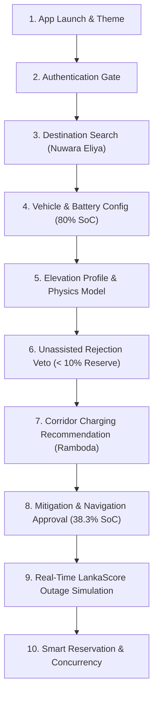

# EVay Lanka: ICACT 2026 Conference Demonstration Readiness Checklist

> **Document Type:** Live Demonstration Verification & Operations Manual  
> **Target Event:** ICACT 2026 Conference Presentation & Live Technical Demo  
> **Source Repository:** `https://github.com/IranthaThisal/EVay_lanka`  
> **Recommended Demonstration Device:** Android Emulator (Pixel 7 / Android 14 API 34) or Physical Android Device with USB Debugging enabled.  

---

## 1. End-to-End Conference Demonstration Script (10-Step Journey)

The following scripted sequence demonstrates the entire physics-informed EV workflow, focusing on the verified **Colombo to Nuwara Eliya (C3)** mountain corridor:

| Step # | User Action | Application Screen | Expected System Response & Visual Feedback | Live Demo Status |
| :---: | :--- | :--- | :--- | :---: |
| **1** | Launch Application | Splash Screen $\to$ Login | `flutter_native_splash` displays, transitions into Auth Gate. Dark/Light mode adapts seamlessly. | **READY** |
| **2** | Authenticate / Sign In | `LoginScreen` (`auth_gate.dart`) | Authenticate via registered test account or Google Sign-In. Transitions to `AppShell` with 6-tab navigation. | **READY** |
| **3** | Navigate to Map & Search | `MapScreen` (`osm_map_view.dart`) | OpenStreetMap renders without API keys. Enter "Nuwara Eliya" in destination search; resolves coordinate $(6.9700, 80.7800)$ via Nominatim/46-city dictionary. | **READY** |
| **4** | Configure Vehicle & Environment | `MapScreen` Bottom Panel | Set Battery: $50.3\text{ kWh}$ (MG ZS EV), Initial SoC: $80\%$, Weather: Light Rain / Heavy Monsoon, Payload: $150\text{ kg}$. | **READY** |
| **5** | Calculate Route & Topography | `MapScreen` Polyline Overlay | OSRM road polyline renders on OSM map. 28-node RBF elevation calculates $+1,858\text{m}$ climb and $+8.2\text{ kWh}$ gravitational penalty. | **READY** |
| **6** | **Demonstrate Safety Rejection** | `_buildRaiCard` & Warning Modal | Direct journey predicted arrival is $6.5\%$ SoC ($< 10\%$ safety reserve floor). **Turn-by-turn navigation is disabled** (`canInitiateNavigation == false`). Red warning alert displayed. | **READY (CORE DEMO)** |
| **7** | Add Recommended Stop | Charger Callout Sheet | Select recommended corridor stop at **Ramboda Falls DC** ($40\text{ kW}$ DC, $1.2\text{ km}$ detour off A7 corridor). | **READY** |
| **8** | **Demonstrate Mitigation Approval** | `_buildRaiCard` Approved | With $16.0\text{ kWh}$ charge ($26.7\text{ mins}$ session), arrival SoC is restored to $38.3\%$ ($\ge 10\%$). **Navigation is approved** (`canInitiateNavigation == true`). RAI score turns green. | **READY (CORE DEMO)** |
| **9** | Demonstrate LankaScore Dynamics | `CheckInSheet` (`checkin_dialog.dart`) | Simulate driver reporting a temporary grid outage at Kurunegala Hub. Score drops from 10.0 to 5.6 via 4-hour recency penalty; route candidate switches automatically. | **READY** |
| **10** | Smart Slot Reservation | `BookingScreen` (`booking_screen.dart`) | Station power auto-calculates duration ($30\text{ min}$). Slot is reserved with OCC conflict prevention; waitlist is demonstrated upon cancellation. | **READY** |

---

## 2. Technical Readiness & Risk Audit

| Component | Assessment & Status | Mitigation / Contingency Plan |
| :--- | :--- | :--- |
| **Google Maps Independence** | **PASSED:** All Google Maps API keys and billing dependencies have been completely eliminated. Map tiles load directly from OpenStreetMap (`tile.openstreetmap.org`). | Zero risk of sudden API quota cutoff or key invalidation during the conference. |
| **Internet Connectivity** | **MIXED:** OSRM and OSM tiles require active HTTP internet. However, offline fallback is built-in: geodesic road-tortuosity ($1.28\times$) and 46-city dictionary calculate routes without internet. | If conference Wi-Fi is unstable, tether to mobile hotspot. Offline fallback will prevent app crashes. |
| **Firebase Services** | **CONFIGURED:** Firebase Authentication, Cloud Firestore, and Firebase Storage are initialized in `firebase_options.dart`. | Pre-authenticate on demo device prior to taking the stage so the app is already logged in on `AppShell`. |
| **Device Execution** | **PREREQUISITE:** Flutter CLI is not on the host terminal PATH. Demo must be launched from an environment where Flutter SDK is connected (e.g. Antigravity IDE, Android Studio, or terminal with configured PATH). | Run `flutter run -d <device_id>` from the configured terminal ahead of time. |
| **Screenshots & Media** | **INTEGRITY RULE:** In accordance with research integrity rules, screenshots must only be captured directly from a running device/emulator, never fabricated or artificially mocked. | Capture live screenshots during the pre-presentation staging run. |

---

## 3. Pre-Flight Presenter Checklist (15 Minutes Before Talk)

- [ ] Ensure device screen lock / sleep timeout is set to 30 minutes or "Never while charging".
- [ ] Connect mobile Wi-Fi hotspot to avoid conference network latency.
- [ ] Launch `EVayLanka` and confirm `AppShell` is visible (already authenticated).
- [ ] Test one quick route lookup ("Colombo to Nuwara Eliya") to warm up map tile cache.
- [ ] Verify battery level slider responds smoothly on `MapScreen`.
- [ ] Keep backup slides ready showing Table IV benchmark comparisons if AV screen mirroring fails.
