# EVay Lanka: Limitations, Scope Boundaries, and Future Work

> **Document Type:** Scientific Scope Definition & Academic Transparency Statement  
> **Target Conference:** ICACT 2026  
> **Source Repository:** `https://github.com/IranthaThisal/EVay_lanka`  

---

## 1. Classification of Project Capabilities

To uphold the highest standards of scientific rigor and IEEE research integrity, this document delineates the four tiers of the EVay Lanka platform:

```mermaid
flowchart TD
    subgraph T1["Tier 1: Implemented Production Code"]
        A1["Pure-Flutter OsmMapView (OpenStreetMap Slippy Map)"]
        A2["OSRM Routing & Polyline Decoding with Geodesic Fallback"]
        A3["28-Node Gaussian RBF Elevation Model of Sri Lanka"]
        A4["Dimensionless Multi-Criteria Cost Function (0.35 / 0.45 / 0.20)"]
        A5["Pre-Departure Battery Reserve Safety Gate (10% Floor)"]
        A6["LankaScore Crowdsourced Reliability & 4-Hour Recency Penalty"]
        A7["SoC Duration Auto-Calculation & Waitlist Queue Architecture"]
    end

    subgraph T2["Tier 2: Automated Test Coverage"]
        B1["16 Test Suites / Groups Across 7 Test Files"]
        B2["Over 160 Automated Mathematical Assertions (100% Pass)"]
        B3["Boundary Value & Infeasibility Unit Assertions"]
    end

    subgraph T3["Tier 3: Simulated Experimental Validation"]
        C1["45 Method-Scenario Evaluations across 5 Corridors (C1-C5)"]
        C2["8 Physics-Calibrated Synthetic Diagnostic CAN Drive Cycles"]
        C3["In-Memory OCC Transaction Testbed (50 Contending Users)"]
    end

    subgraph T4["Tier 4: Planned Real-World Empirical Research"]
        D1["Physical On-Road Instrumented Vehicle Fleet Data Collection"]
        D2["Direct OCPP 2.0.1 / OCPI Operator Telemetry Integration"]
        D3["Human-Subject Psychometric Range Anxiety Studies"]
        D4["Wide-Area Cellular Network Firestore Partition Profiling"]
    end

    T1 --> T2
    T2 --> T3
    T3 --> T4
```

---

## 2. Explicit Scope Limitations

### 2.1 Benchmark Data Provenance (Synthetic vs. Physical CAN Logging)
* **Current Status:** The 8 diagnostic traces in `data/telemetry/` (`OBD-2026-0312-C1.csv` through `OBD-2026-0405-A1.csv`) are **physics-calibrated synthetic reference traces** generated using the Newtonian mechanical generator `tool/export_obd_traces.dart`.
* **Scope Boundary:** They model the exact signal schema, sampling rates ($0.5\text{ Hz}$), and PID structures of an OBDLink MX+ scanner on an MG ZS EV standard range pack ($50.3\text{ kWh}$).
* **Limitation:** They do not represent physical hardware acquisition logged by an instrumented vehicle driven on Sri Lankan roads. While they provide a completely transparent and deterministic reference testbed, they cannot validate unmodeled physical phenomena (e.g., cell balancing variations, degradation aging, battery internal resistance heating).

### 2.2 Booking Concurrency (In-Memory OCC vs. Cloud Firestore Infrastructure)
* **Current Status:** Concurrency isolation was evaluated using an in-memory transactional testbed (`InMemoryReservationEngine`).
* **Scope Boundary:** The benchmark proves application-level optimistic concurrency logic, atomic bay capacity bounding, conflict rejection, and FIFO waitlist promotion.
* **Limitation:** It does not evaluate live Google Cloud Firestore network round-trip latencies, global clock drift, or wide-area cellular connection dropouts in rural Sri Lankan transit corridors.

### 2.3 Station Reliability Data (Crowdsourced Reports vs. Live CPO Telemetry)
* **Current Status:** LankaScore aggregates community driver check-ins (`ChargerCheckIn`) submitted via the mobile interface.
* **Scope Boundary:** Incorporates fault categorization (CEB grid cuts, tripped breakers, station offline, ICE-ing) with a 4-hour stepwise recency penalty.
* **Limitation:** The platform relies on active user participation. In low-density transit corridors with infrequent check-ins, station scores remain at baseline default ($9.0/10$) until a driver logs an incident. It does not replace automated IoT / OCPP live socket telemetry from Charge Point Operators (CPOs).

### 2.4 Range Anxiety Index (Operational Feasibility vs. Psychometric Anxiety)
* **Current Status:** Formulated as a composite engineering metric ($w_b=0.50, w_r=0.30, w_c=0.20$) bounded to $[0, 100]$.
* **Scope Boundary:** Operates as a deterministic indicator of energy reserve buffers and charger accessibility.
* **Limitation:** It is an engineering heuristic indicator, not an empirically validated psychological measurement of human driver anxiety. Human perception of range anxiety involves psychological risk tolerance, passenger count, and nighttime driving factors not captured by physics formulas alone.

### 2.5 Offline Routing Capabilities (Approximate Screening vs. Vector Turn-by-Turn)
* **Current Status:** Built-in 46-city Sri Lankan centroid dictionary with geodesic road-tortuosity factor ($1.28\times$) and average speed ($45\text{ km/h}$).
* **Scope Boundary:** Provides zero-latency failsafe distance, duration, and energy feasibility screening when the remote OSRM server is unreachable.
* **Limitation:** It does not store an offline vector road topology graph (such as an offline Valhalla or GraphHopper SQLite database) and cannot provide turn-by-turn lane guidance without internet connectivity.

---

## 3. Recommended Future Work

1. **Hardware Fleet Datalogging:** Deploy OBDLink MX+ loggers across a pilot fleet of 10 commercial and private EVs in Sri Lanka to collect multi-month CAN telemetry under real-world traffic and monsoon flash-flooding.
2. **CPO Protocol Integration:** Implement Open Charge Point Interface (OCPI 2.2) adapters to ingest live charger socket occupancy and CEB substation grid telemetry directly from ChargeNet and CEB networks.
3. **Embedded Vector Offline Engine:** Package an offline routing tile pack (e.g., Valhalla mobile engine) for true offline topological turn-by-turn navigation in remote areas of the Central Highlands.
4. **Machine Learning Residual Correction:** Train a lightweight on-device regression model (e.g., XGBoost or TensorFlow Lite) on physical fleet telemetry to refine the Newtonian physical predictions based on real-time driver aggression and battery state-of-health (SoH).
